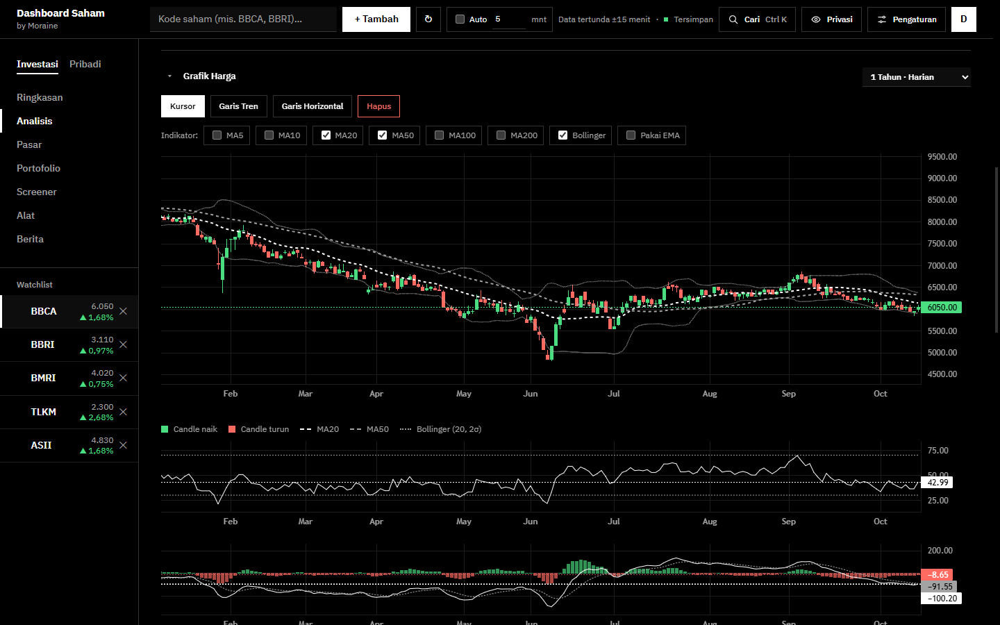
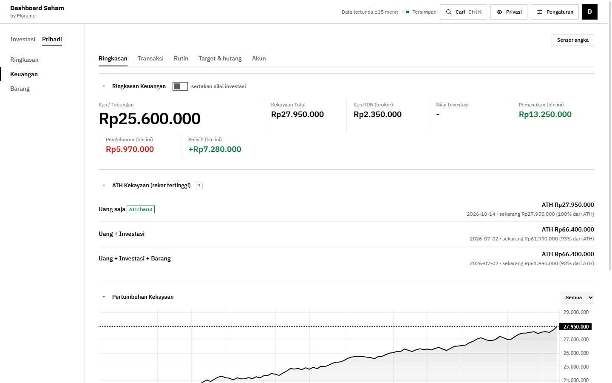

https://github.com/user-attachments/assets/13b8a105-a731-42e4-91de-cc4aa9b0fc0a

# Dashboard Saham

A self-hosted dashboard for the Indonesian stock market (IDX) and personal finance, by Moraine.
It runs on your own computer, keeps your data there, and you open it in a browser on that
computer or, if you choose, on your phone. The interface is in Indonesian.





The screenshots use made-up demo data.

> **Not investment advice.** This is an educational tool. Market data comes from Yahoo Finance
> through yfinance and is delayed by about 15 minutes.

## Features

**Investasi** (investing)

| Menu | What it does |
|---|---|
| Ringkasan | Overview: portfolio value, watchlist movers, IHSG and global markets |
| Analisis | Candlestick chart from 5 minutes to monthly with MA/EMA, Bollinger, RSI, MACD and trend lines; a multi-perspective technical signal; fundamentals and valuation; quarterly results; fair value, dividend, position and risk calculators; compare up to 4 stocks |
| Pasar | IHSG and global markets, the Rupiah against major currencies, gold and silver with an IDR per gram estimate |
| Portofolio | Stocks, mutual funds, bonds with coupon schedules, broker cash (RDN), performance against IHSG, value against cost, dividends, sector allocation, ex-dividend agenda, a trade journal with realized P/L, IPO notes |
| Screener | Filter 47 liquid IDX stocks by PER, PBV, ROE, dividend yield and sector, with a 0-100 fundamental score |
| Alat | ARA/ARB price-limit simulation, average-down calculator, position calculator |
| Berita | Market and stock news from Google News RSS with rule-based impact and sentiment labels |

**Pribadi** (personal)

| Menu | What it does |
|---|---|
| Keuangan | Net worth and its record high, income and spending, monthly recurring items, savings targets, debts and reimbursements, accounts |
| Barang | Purchase projects and wishlists, linked to Keuangan |

Also: a watchlist in the side rail, quick search with `Ctrl+K`, a privacy mode that blurs every
amount, dark (Hitam) and light (Putih) themes, text size and density settings, a configurable
menu, decorative photo cards, JSON export and import, and sync between every browser that signs
in. AI analysis is optional; without it the app shows rule-based summaries.

## Requirements

- Python 3.11 or newer (developed on 3.14)
- Internet access, for market data, news and the chart library
- A current browser: Chrome, Edge, Firefox or Safari

## Quick start

1. Download or clone this repository.
2. Start it:
   - **Windows:** double-click `start.bat`.
   - **macOS or Linux:** run `./start.sh` in a terminal.

   The first start creates a private Python environment in `.venv` and installs the
   requirements, which takes a minute. Later starts are quick.
3. The browser opens `http://127.0.0.1:5000` at the first-run setup page. Choose the app name
   (you can change it later) and the owner password (8 characters or more).

Keep the window open while you use the app, and press `Ctrl+C` in it to stop.

To start it by hand instead:

```bash
python -m venv .venv
.venv/bin/python -m pip install -r requirements.txt   # Windows: .venv\Scripts\python
.venv/bin/python app.py
```

### The setup code

Until an owner exists, the console shows a one-time **first-run code**. When the app opens the
browser itself, the code is already filled in. Otherwise, type it into the setup page.

Setup only works on the computer that runs the app. Another device sees a short explanation
instead of the form.

## Use it from your phone

By default the app only answers on the computer it runs on. To open it from other devices on
the same network:

1. Copy `.env.example` to `.env` and set `FLASK_HOST=0.0.0.0`.
2. Restart the app. The console prints the address to use, such as `http://192.168.1.20:5000`.
   On Windows, allow Python through the firewall when asked.
3. Optional: set `MDNS_NAME=dashboard` and run `pip install zeroconf` to also reach it as
   `http://dashboard.local:5000`.

Everyone on that network can reach the sign-in page, so use a strong password. Do not forward
the port to the internet. For access away from home, use a VPN to your home network, or a
reverse proxy with HTTPS and `SESSION_COOKIE_SECURE=1`.

## Configuration

Settings go in a `.env` file next to `app.py`; [`.env.example`](.env.example) lists every one.
Real environment variables win over `.env`. Restart the app after a change.

| Setting | Default | Purpose |
|---|---|---|
| `FLASK_HOST` | `127.0.0.1` | `0.0.0.0` lets other devices connect |
| `FLASK_PORT` | `5000` | Port |
| `OPEN_BROWSER` | `1` | `0` stops the browser from opening at start |
| `DATA_DIR` | `data` | Where data is kept |
| `MDNS_NAME` | off | Name announced as `<name>.local` (needs `zeroconf`) |
| `APP_NAME` | asked at setup | App name for a fresh install |
| `OWNER_PASSWORD` | none | Owner password for a fresh install, instead of the setup page |
| `MASTER_ADMIN_PASSWORD` | none | Administrator password (see Security) |
| `FLASK_SECRET_KEY` | random, kept in `DATA_DIR` | Session signing key |
| `SESSION_COOKIE_SECURE` | `0` | `1` only behind HTTPS |
| `STOCK_AI_PROVIDER` | `none` | `ollama`, `lmstudio`, `local` or `anthropic` |
| `STOCK_AI_MODEL` | `gemma4:e4b` locally, `haiku` for Claude | Model name |
| `STOCK_AI_BASE_URL` | per provider | OpenAI-compatible endpoint |
| `STOCK_AI_API_KEY` | none | Key for a local server that needs one |
| `ANTHROPIC_API_KEY` | none | Claude API key |

## Optional AI

AI is off by default. Turn it on in **Pengaturan › Tampilan › AI**, which uses Ollama unless
`STOCK_AI_PROVIDER` says otherwise. It writes narrative stock analysis, answers questions about
a stock, briefs the news, and reviews Keuangan and Barang.

- **Ollama** (local, free): install [Ollama](https://ollama.com), run
  `ollama pull gemma4:e4b` (or set `STOCK_AI_MODEL` to a model you have) and keep it running.
- **LM Studio** (local): start its local server, then set `STOCK_AI_PROVIDER=lmstudio` and
  `STOCK_AI_MODEL` to the loaded model.
- **Any OpenAI-compatible server**: `STOCK_AI_PROVIDER=local`, `STOCK_AI_BASE_URL`, and
  `STOCK_AI_API_KEY` if it needs one.
- **Claude API** (cloud, paid per use): `pip install anthropic` into the app's environment, then
  set `STOCK_AI_PROVIDER=anthropic` and `ANTHROPIC_API_KEY`. `STOCK_AI_MODEL` takes `haiku`
  (default), `sonnet`, `opus` or a full model ID.

With a local provider nothing leaves your computer. With the Claude API, each AI request sends
the figures it is about to Anthropic: stock data and headlines, and for the Keuangan and Barang
reviews your balances, cash flow, targets and items.

## Security

- Every page and data API needs a signed-in session. Sessions end 12 hours after sign-in.
- Passwords are stored as scrypt hashes on the server, never in the browser. Changing the owner
  password signs out every other device.
- The session cookie is `HttpOnly` and `SameSite=Strict`, and every change needs a CSRF token.
- Sign-in allows 8 failed attempts per address every 5 minutes.
- First-run setup only works on the computer running the app, needs the one-time code, and
  refuses requests that come through a proxy.
- Responses carry a strict Content Security Policy. The only outside script is the chart library,
  pinned to one version and checked with Subresource Integrity.
- An administrator password, if set, lets someone sign in with **Masuk sebagai administrator**
  on the login page and reset the owner password without the old one.

The app does not serve HTTPS itself. It is meant for one owner on a trusted home network.

## Data and backups

Everything lives in the data folder (`data/` unless `DATA_DIR` says otherwise):

| File | Contents |
|---|---|
| `state.json` (and `state.json.bak`) | Everything you enter, with the previous copy |
| `owner.json`, `admin.json` | Password hashes |
| `app.json` | App name |
| `session_secret` | Session signing key |
| `photocards/` | Photo card images |
| `cache/` | Market data cache |

- **Back up:** stop the app and copy the data folder. To restore, stop the app, put the copy
  back, and start it again.
- **Export and import:** Pengaturan › Data & cadangan saves or loads your data as one JSON file
  (without passwords or photo cards).
- **If `state.json` cannot be read**, the app keeps a copy as `state.json.corrupt-<time>`,
  refuses to save, and never treats your data as empty. Stop the app, and put
  `state.json.bak` or a backup in its place.
- **Forgot the owner password?** Stop the app, delete `owner.json` from the data folder, and
  start again: the first-run setup appears, and your data stays.

Keep the data folder and `.env` out of git; `.gitignore` already does.

## Development

```bash
python -m unittest discover -s tests   # Python tests; market data is mocked, no network needed
node --test tests/*.test.js            # JavaScript tests (Node.js 18 or newer)
```

```
app.py           Flask server: sign-in, state sync, market data, cache
indicators.py    Technical indicators and the signal score
news.py          News feed with impact and sentiment labels
ai.py            Optional AI providers with rule-based fallbacks
tickers.py       IDX ticker names for search
templates/       index.html (dashboard), login.html, fresh-start.html
static/          one JavaScript module per feature, css/, fonts/, icons
tests/           Python and Node tests
```

## Limitations

- One owner per installation.
- Prices are delayed about 15 minutes, not real time. The BI rate is entered by hand.
- The screener covers 47 liquid stocks, not the whole exchange.
- The chart library loads from unpkg.com, so charts need internet access.
- Desktop first; below 1024 px the menu becomes a slide-out drawer.

## License

MIT, copyright (c) 2026 Moraine. See [LICENSE](LICENSE).

Charts by [TradingView Lightweight Charts™](https://www.tradingview.com/). Fonts, libraries and
data sources are credited in [THIRD_PARTY_NOTICES.md](THIRD_PARTY_NOTICES.md).
